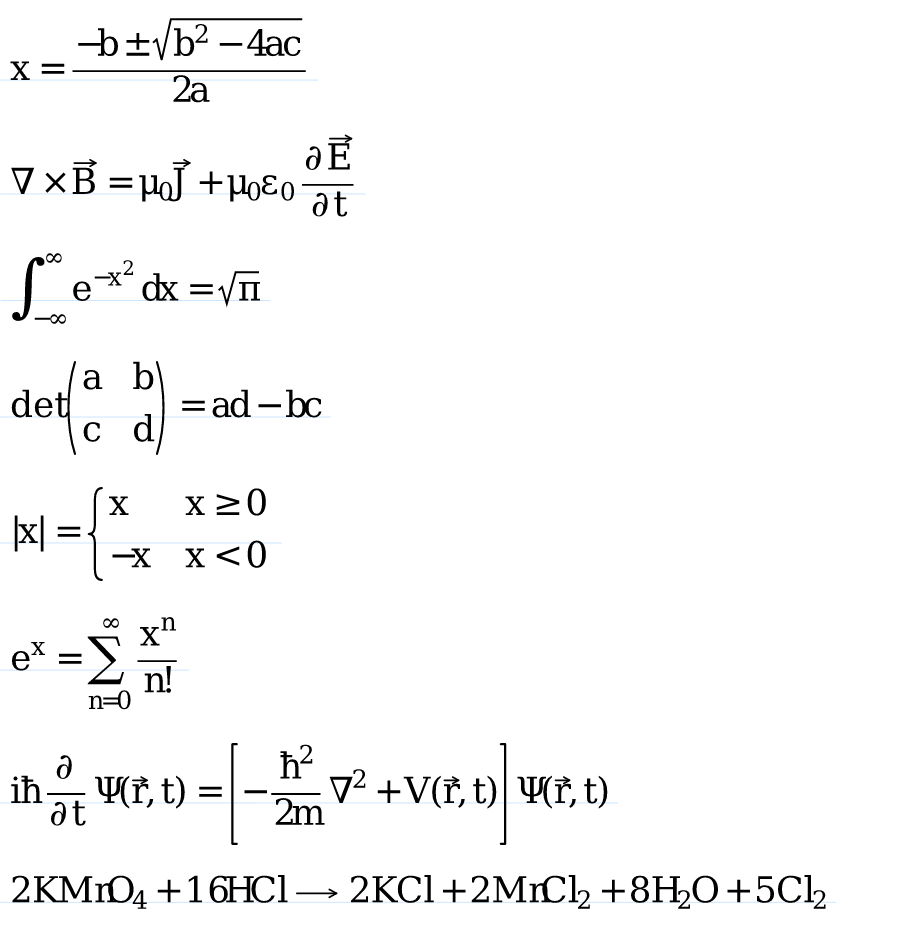

# Adobe Illustrator Advanced Mathematical & Scientific Equation Editor

**Created by Shohan Khan** · MIT License · single-file ExtendScript (`.jsx`) for Adobe Illustrator CC 2015 and later

Build mathematical, physical and chemical equations in a ScriptUI dialog — visually, from templates, or by typing LaTeX-style syntax — and insert them into Illustrator as **native, editable artwork**: real text frames for glyphs and vector paths for fraction bars, radicals, stretchy brackets and arrows, collected in a named group that can be selected and **re-edited later**.



*The geometry above comes from the editor's layout engine, rendered to SVG with a substitute font and approximate glyph widths. It is not an Illustrator screenshot. Inside Illustrator, glyph widths are measured from the fonts you choose.*

> **Testing status.** The engine, UI wiring and renderer logic are covered by 138 automated tests, including a run with every ES5 built-in removed to emulate ExtendScript. The script has **not yet been run inside Adobe Illustrator** because none was available while building it. See [COMPATIBILITY](docs/COMPATIBILITY.md) and [TEST_REPORT](docs/TEST_REPORT.md).

## Download

Get **`Shohan_Khan_Illustrator_Math_Scientific_Equation_Editor.jsx`** from the [latest release](https://github.com/peraccofshohan-lgtm/illustrator-math-scientific-equation-editor/releases/latest). It is the only file you need.

## Quick start

1. In Illustrator, open or create a document.
2. Choose **File › Scripts › Other Script…** and pick the `.jsx` file. To make it permanent, see [INSTALLATION](docs/INSTALLATION.md).
3. Type `x = \frac{-b \pm \sqrt{b^2-4ac}}{2a}` in **Direct Input**, or pick a template.
4. Press **Insert Equation** (Ctrl/Cmd+Enter).
5. To edit it later, select the equation, run the script again, change it, and press **Update Equation**.

## Highlights

| Area | What you get |
|---|---|
| Input | Visual Equation Builder, Direct Input (LaTeX-style syntax with line and column error reporting), 383 templates, 743 symbols in 30 categories. All of them share one structure (AST) with two-way sync. |
| Structures | Fractions, roots, scripts and prescripts, matrices and determinants (up to 100×100), vectors, integrals (single to volume, contour), sums and products, limits, derivatives, piecewise functions, multiline and aligned equations, accents, braces, boxes, units, scientific notation. |
| Chemistry | `\ce{…}` notation, all 118 elements, charges, isotopes, states, hydrates, reaction arrows with conditions, and **exact balancing** with atom- and charge-count verification. |
| Output | Editable group (default), separate components, single text object (for simple expressions), or outlined artwork. Outlines are never the default. Insertion rolls back completely on failure. |
| Formatting | Fonts (math font detection and recommendations, missing-font warnings), size, colour, bold/italic, spacing, bar and stroke thickness, script scale and offsets, matrix spacing, presets, per-element overrides. |
| Library | Save, load, duplicate, rename, delete, favorite and search formulas; custom templates; recent and favorite symbols; versioned JSON import/export (parsed strictly, never executed). |
| Editing | Undo/redo with bounded history, click-to-select in the live preview, structure tree, keyboard shortcuts. |

## Documentation

- [User Guide](docs/USER_GUIDE.md)
- [Installation](docs/INSTALLATION.md)
- [Features](docs/FEATURES.md)
- [Troubleshooting](docs/TROUBLESHOOTING.md)
- [Compatibility](docs/COMPATIBILITY.md)
- [Architecture](docs/ARCHITECTURE.md)
- [Test Report](docs/TEST_REPORT.md)
- [Changelog](CHANGELOG.md)
- [Contributing](CONTRIBUTING.md)
- [Security](SECURITY.md)

## Building from source

```
npm install          # dev dependency: acorn (ES3 syntax check)
npm run build        # concatenates src/modules/*.jsx -> release/…jsx
npm test             # build + 138 automated tests
npm run verify-build # checks the committed asset matches the sources
```

The runtime has no dependencies: the release is a single self-contained ES3 file.
